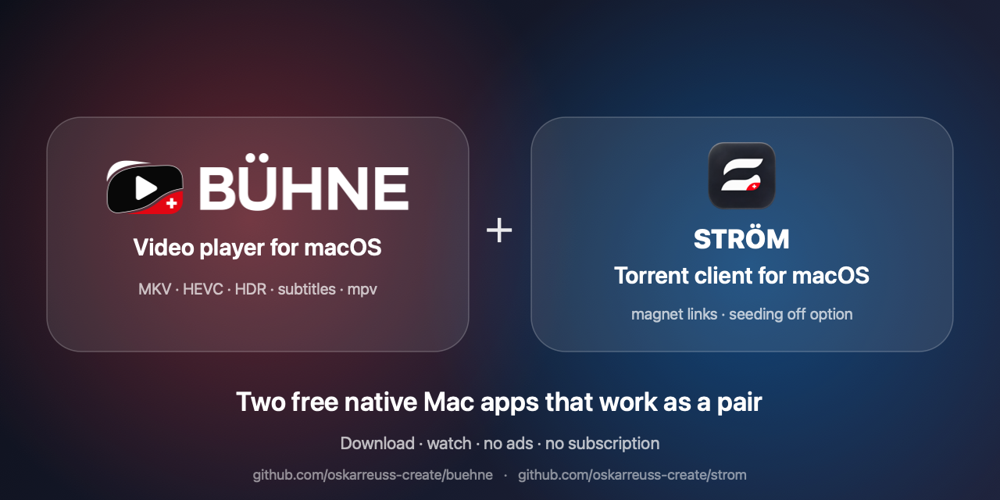
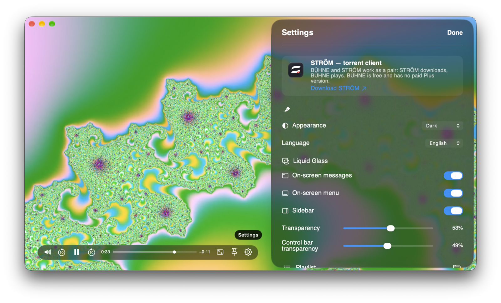

# BÜHNE

[English](README.md) · [Deutsch](README.de.md) · [Русский](README.ru.md)

**A light, beautiful, native video player for macOS — the companion of [STRÖM](https://github.com/oskarreuss-create/strom).**



Free **video player for Mac** (macOS 26, Apple Silicon): plays **MKV, MP4, AVI, HEVC / H.265, HDR** with hardware decoding, subtitles and audio tracks, a floating always-on-top window and a Liquid Glass look. Native Swift / SwiftUI app built on **libmpv**, an alternative to VLC, IINA and QuickTime for people who want a light, quiet **mpv player for macOS**. Works with the **STRÖM torrent client** so you can **watch torrents while they download**.

> STRÖM downloads, BÜHNE plays. The two apps are built as a pair and share one look. BÜHNE is free, with no time limit and no paid "Plus" version.




## Main features
- **Plays everything.** MP4, M4V and MOV natively (AVFoundation); MKV, AVI, HEVC / H.265 and the rest through libmpv. Hardware decoding.
- **One-line floating control bar.** Drag it to six positions; it sheds parts as the window shrinks, down to three buttons.
- **Always-on-top floating window** and picture-in-picture.
- **Remembers where you stopped.** Playback position is saved per file; reopening continues from there.
- **Playlist from a folder** (video files only), optionally on the control bar.
- **Speed 0.5–3×**, audio and subtitle tracks, aspect, crop, rotation, black-bar detection.
- **Liquid Glass look.** Light, dark or auto; adjustable glass transparency.
- **6 languages.** English (default), Deutsch, Français, Italiano, Русский, Español.
- **Keyboard control.** Space, ← → seek 10 s, ↑ ↓ volume, F full screen, M mute, [ ] speed, A / S audio / subtitle track, ⌘O open, ⌘, settings.
- **Free.** No time limit, no ads, no paid "Plus" version. Works with the STRÖM torrent client: watch while it downloads.

## Works with STRÖM
STRÖM is a light BitTorrent client for macOS with the option to turn off seeding. Download it from [its Releases page](https://github.com/oskarreuss-create/strom/releases) — the link is also in BÜHNE's settings.

Watch while it downloads: press Play in STRÖM and BÜHNE opens the video as it arrives. You cannot jump past the part that has already been downloaded.

## Requirements
macOS 26 or later, Apple Silicon, and [mpv](https://mpv.io) from Homebrew:

```bash
brew install mpv
```

## Install
1. Download `Buehne-<version>.zip` from [Releases](../../releases) and move BÜHNE to Applications.
2. The app is not signed with an Apple Developer ID and is not notarized, so macOS shows a warning on first launch. Open *System Settings → Privacy & Security*, find BÜHNE and click **Open Anyway**. Or run:

```bash
xattr -dr com.apple.quarantine /Applications/Buehne.app
```

## Build from source
You need Xcode (Swift 6.2) and `brew install mpv`.

```bash
swift test
./scripts/make-app.sh      # produces build/Buehne.app (ad-hoc signed, local use only)
```

Open a file from the command line: `Buehne /path/to/file.mkv` or `buehne://open?path=...`. Details: [BUEHNE_CONTRACT.md](BUEHNE_CONTRACT.md).

## Privacy
No tracking, no ads, no cookies, no accounts, no network calls of its own (apart from streaming an http/https address you ask it to play). Playback positions and settings stay on your Mac. The only link to the internet is the "Download STRÖM" button in settings, which opens your browser.

## License
Source code is available under the [PolyForm Noncommercial License 1.0.0](LICENSE): you may read, modify and use it for personal and non-commercial purposes. Selling it, publishing paid forks or commercial use without permission is not allowed. See [NOTICE](NOTICE). libmpv and FFmpeg are not part of this repository and keep their own licenses. Other terms: info@oskarreus.ch.

## Support
Questions and bugs: [Issues](../../issues) or info@oskarreus.ch.
